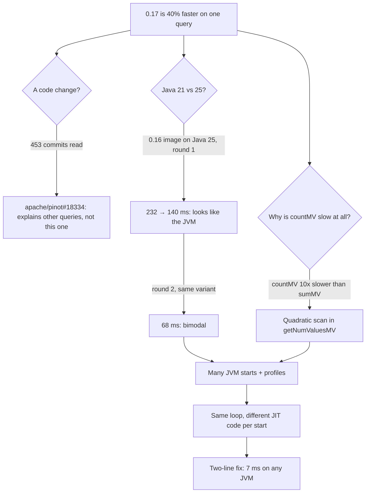

## An excessively long and philosophical intro

Not a day goes by without news about the impact of AI, some of it more fatalistic than the rest.
Some say that AI will end work as we know it.
Some think that we will live in a solarpunk world where work is optional, or where we work very few hours.
Others see a darker future, with mass unemployment, as more likely.
And there are those who think that, as it has done in the past, the market will adjust on its own, and the extra productivity will open many new niches to exploit.
So we will keep working the same, but producing and consuming more.

The truth is that I do not really know where I stand in that wide spectrum.
What I do experience every day is that AI makes my work much more productive.
It lets me focus on what matters, and it solves problems in ways I could not have imagined.
That is exactly what I want to talk about in the first post of this blog.

## The crux of the matter

At StarTree, where I work, we have our own distribution of Apache Pinot, with a set of proprietary extensions.
We also cut our own releases, which do not follow the Apache Pinot cadence.
While in Apache Pinot we are thinking about releasing 1.6.0, in StarTree Pinot we are running performance tests on version 0.17, which derives from an Apache Pinot commit close to 1.6.0.

During these tests, we saw that some queries were significantly faster on 0.17 than on 0.16.
One of them stood out:

```sql
SELECT
  count(*),
  countMV(commit_author_names),
  countMV(label_ids)
FROM github_events
```

It was almost 40% faster on 0.17: 142 ms before, 86 ms after.
A performance change that big usually comes from a code change.
The problem was that none of us, the committers of the query engine, had any idea what could have made that query faster.
Nothing in the release touched `countMV`, and the query is about as simple as an aggregation can be.

If this had happened a few years ago, we would probably have taken it as good news.
Maybe it would have bugged someone enough to spend a bit of time on it, but the priority would have been low.
The team has plenty of other tasks, and explaining a speedup in a rarely used aggregation function did not look that important right now.
Besides, it so happens that 0.16 runs on Java 21 while 0.17 runs on Java 25, so we had the Java upgrade as a theoretical excuse.
Surely the cause was some JIT or GC optimization in the new Java version!

But... what happens if the engineer asks an AI like Opus 5.5 to look into it?
This post is about what happened when, instead of shrugging, I spent a prompt on it.

## The prompt

This is the prompt I gave Claude Code, translated from Spanish:

> We are running some tests comparing the performance of StarTree Pinot 0.16 with 0.17.
> The results are in this report (link). One of the most significant is GitHub events query aggregation-1. [...]
> This query is almost 40% faster in the new version. We, the query engine experts, do not know where such an improvement could come from, and we think it is noise or something situational.
> I want you to study what may be happening. You can use `galador`, where you can `docker pull` to get the images.
> You can also build the code of the different branches yourself, or use async-profiler or the skill to debug Java.
> Also check whether some config is different between versions. [...]
> One change that certainly exists is that 0.16 and 0.17, in Docker, use different Java versions (21 for 0.16 and 25 for 0.17).

That is all the direction it got.
I was probably too specific.
Claude could have inferred most of the ideas I gave it, but I wanted to nudge it to load the different skills I already had configured.[^skills]
I named the suspect I believed in (the JVM), gave it a machine[^galador], and let it work.

## What Claude did, and how long it took

I did not watch the investigation.
I had other, higher-priority tasks to attend to.
At 45 minutes, Claude had already set up the cluster and found that, by mistake, the code had quadratic cost instead of linear.
At an hour and a quarter, it had already taken my JVM theory apart!
It is true that it took about 3 hours in total to verify its findings, mostly because it wanted to be thorough and start different JVMs many times.
But during all that time I could work on other, higher-priority tasks.

This is the timeline, measured from the session:

| Time | What happened |
|---|---|
| 0:00 | Prompt. Claude reads the report, finds the exact builds, and lists the 453 open source commits between the two versions. |
| ~0:20 | It finds a real change, apache/pinot#18334, that lets Pinot answer some aggregations from the dictionary without a scan. It explains two other faster queries, but not this one. |
| ~0:30 | It creates a local cluster on galador: ZooKeeper, controller, broker and server in Docker, with the same public dataset (546,496 rows) and a server with 6 CPUs, like in the benchmark. |
| ~0:45 | The first numbers for 0.16 show something odd: counting the values of a column is ten times slower than adding them. Claude reads the code and finds a quadratic loop. |
| ~0:50 | The key cross-test: the 0.16 image with Java 25 mounted in. The query goes from 232 ms to 140 ms, the same 40%. It looks like my hunch was right. |
| ~1:15 | The second round of the same matrix: 0.16 on Java 25 now takes 68 ms. The result is bimodal. The "it is Java 25" story falls apart. |
| ~1:50 | Profiles of several JVM starts: the same loop takes all the time in every start, but the JIT compiles it differently each time. |
| ~3:25 | Confirmed with seven JVM starts per variant and a two-line patch: the query drops to about 7 ms, on Java 21 and on Java 25. |
| +0:20 | The fix is a pull request to Apache Pinot. |

This is the path of the investigation, with its dead ends:



Most of those three and a half hours were benchmarks running in the background on galador.
They used a lot of CPU and memory for quite a while, but on another machine, so neither my laptop nor my day was affected.
I did not have to babysit a Docker cluster or keep a terminal open (well, yes, but only because Claude Code runs in the terminal!).
I also tend to take my time to answer Claude when a task is low priority, like this one.
Here it did not matter: the investigation did not need a single answer from me until the end.

## The part where my hunch was wrong

Two moments in that timeline matter more than the rest.

The first one is at 0:45.
In the first numbers for 0.16, on the same column, `countMV(label_ids)` took 105 ms and `sumMV(label_ids)` took 11 ms.
Counting values was ten times slower than adding them.
If anything, it should be the other way around: counting should be faster than adding.
Claude understood that, so it read the reader code.
In Pinot, `getNumValuesMV`, the method that returns how many values a row has, reads the current position from a reader context but never writes it back.
Its sibling, `getDictIdMV`, does update the context.
This is the method before the fix, simplified:

```java title="FixedBitMVForwardIndexReader.java" {9-11,13-14,18-19}
/// Context is an object that carries, among other things, the current read position.
/// Sometimes a read skips positions, for reasons that do not matter here.
/// That is why the code has one branch for the fast, sequential case, and another one
/// for skipped rows. Because finding where a row starts means counting bits in a bitmap,
/// skipping rows costs time linear in the size of the skip.
public int getNumValuesMV(int docId, Context context) {
  int startIndex;
  // for historical reasons, Pinot calls a _row_ a `docId`
  if (docId == context._docId + 1) {
    // Next doc: O(1). Never taken, because the context never moves.
    startIndex = context._endOffset;
  } else {
    // Any other doc: scan the bitmap, byte by byte, to find where the doc starts.
    startIndex = _bitmapReader.getNextNthSetBitOffset(chunkOffset + 1, indexInChunk);
    // (simplified: there is also a "same chunk" variant of this scan)
  }
  int endIndex = _bitmapReader.getNextSetBitOffset(startIndex + 1);
  // before returning, we should update context._docId so that the next read
  // is sequential, but we don't!
  return endIndex - startIndex;
}
```

Without that update, every row starts scanning a bitmap byte by byte again from the start of its chunk, so the cost per chunk is quadratic.
`async-profiler` confirmed it later: almost all of the CPU time was in that scan.

That explained why the query was slow, but not why 0.17 was faster.
The cross-test at 0:50 seemed to answer that: same Pinot code (ST 0.16), only the JVM changes, and the query is 40% faster.
That would have been the perfect place to stop and write "confirmed, it is the JVM" in the release thread.
Someone could think that Java 25 is especially good at cases like this one, and that it optimizes the code somehow to reduce the cost of this quadratic work.

The second moment is at 1:15.
The truth is that the JVM is very good, but not that good.
The benchmark ran every variant twice, interleaved, and the second run of the same variant gave a different answer: 68 ms instead of 140 ms.
Claude did not try to explain the difference away as noise.
It treated it as the most interesting data point so far, profiled several JVM starts, and ran more starts of each variant.

These are the results, with the same binary and the same warmup in every start:

| Variant | Query latency per JVM start (ms) |
|---|---|
| 0.16 on Java 21 | 232, 237, 68, 240, 235, 187, 69 |
| 0.16 on Java 25 | 140, 68, 185, 68, 235, 46, 46 |
| 0.17 on Java 25 | between 62 and 73 in all seven starts |
| 0.16 with the fix | 7.9 and 7.5 (Java 21); 7.3 and 7.2 (Java 25) |

The same binary, on the same JVM, can be five times faster or slower depending on how the JIT compiles that loop in that start.
The release benchmark deployed each version once and ran its three passes on the same JVM, so it measured one roll of that dice per version.
That is why the variance looked tiny.

The details, with the profiles and an analysis of what the JIT does in each case, will be in a follow-up post.

## The fix nobody would have prioritized

The fix ([apache/pinot#19992](https://github.com/apache/pinot/pull/19992)) is two lines:

```diff lang="java"
       endIndex = _bitmapReader.getNextSetBitOffset(startIndex + 1);
     }
+    context._docId = docId;
+    context._endOffset = endIndex;
     return endIndex - startIndex;
```

There is nothing clever in it.
The method next to it already did exactly this.
The query went from 46–240 ms, depending on the JVM start, to 7 ms.

My bet is that `getNumValuesMV` started as a copy of the lookup logic, and the last step got lost on the way.
It is the kind of omission that a review misses, because the code looks complete, and that tests miss, because the result is correct.
At least for a human.
An AI acting as a reviewer could probably have found the problem.
The PR that introduced this feature, [apache/pinot#8953](https://github.com/apache/pinot/pull/8953), changed almost 3,000 lines of code.
And, as a curiosity, that same PR does update the context in the method right above.
A review like that can be heavy for a human, but it is nothing for an AI that is asked to check correctness and also performance.

I want to make one thing clear.
My team could have found this.
It would have been easy to set up a cluster and replay the benchmark with `async-profiler` on.
Maybe we would have missed testing with different JVMs to catch the change in timings caused by the JIT _lottery_, but I have no doubt that we would have found the performance bug.
The question is how many more useful things we could have done in that time.
Besides, counting the values of a multi-value column is not a common operation, the "regression" was a speedup, and there is always something more urgent.
Without a cheap way to dig, this would have stayed as "probably the JVM" forever, and the quadratic loop would still be there.
Maybe some day, when we run the same benchmark for 0.18, the JIT would happen to compile the expensive version, and then spending more time on the _regression_ would become a priority.

## Where I corrected Claude

Claude did not get everything right, and the place where it went wrong is interesting.

To understand it, you need to know how our benchmark works.
Each version is deployed once.
Then three passes run on the same JVM, and in each pass every query runs in a burst for 120 seconds.
Because the three passes share the same JIT compilation, their times are very close to each other, even when that compilation came out especially good or bad.

Claude recommended restarting the servers between passes, so that each pass would be an independent sample of the JIT.
Statistically it is right, but that is not what we are looking for.
This benchmark is not meant to measure the JIT lottery.
It is meant to catch regressions in our changes, with numbers that look like production.

A production server does not run one query on a freshly started JVM.
It runs a mix of queries, and the JIT compiles the shared code with that mix in its profiles.
If the JIT only sees one query, it can specialize the code for it, and in general those numbers will be better than production.
Not always: in this case, warming up with only the slow query gave the worst times of all, as I explain in the next post.
Either way, they describe a JIT state that production never sees.

So there are two proposals that I think are right:

1. Use the same JVM for all the tests, with a warmup that runs a variety of queries in random order, and then measure each query.
2. Use a new JVM per burst, with that same warmup before each one.

The first one is probably better, because the warmup runs only once and the whole test takes much less time.
The second one gives independent samples, at the cost of repeating the warmup for every burst.

Claude took the correction and added it to the summary for the team.
I think this is the right split of work.
Claude is very good at turning a question into experiments and data.
Deciding what the benchmark is for is still my job.

## What changes

None of the steps in this story is new.
Read a diff, reproduce in Docker, cross two JDKs, profile, repeat with more samples, patch, and measure again.
I have done every one of them by hand at some point.

What has changed is the cost of getting started.
Before, following this hunch would have cost me a day or two on a problem with no deadline, and I would not have done it.
Now it costs a prompt, a spare machine and a few minutes of reading at the end.
At that price, I can follow hunches without putting other tasks at risk.
Sometimes the answer is boring.
This time it was a performance fix.

Two questions are still open, and I will come back to them: why 0.17 was fast in every start when the hot code is identical, and how we change the release benchmark so that it cannot be fooled like this again.

[^skills]: This investigation did not need a debugger, but skills like [jdb-agentic-debugger](https://github.com/brunoborges/jdb-agentic-debugger), by Bruno Borges, deserve a post of their own!

[^galador]: What is `galador`? A 24-core box I have at home to build code and run benchmarks.
    The name comes from Galador, a city in [Reinos de Leyenda](https://www.reinosdeleyenda.es/), the MUD where I learned to program.
    Claude already knew how to connect to it over SSH, thanks to a document where I keep the machines on my home network and how to reach them, so I did not have to set anything up for it.
