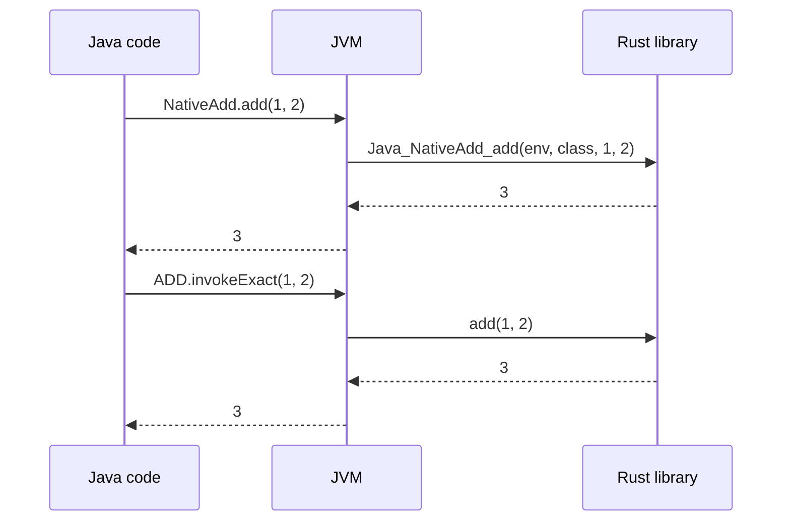

This post calls the smallest useful native function, `add(a, b)`, from Java in two ways.
First with the Java Native Interface (JNI), then with the Foreign Function & Memory (FFM) API from Project Panama.
The function is trivial on purpose: the interesting part is the bridge, not the work.

## The native side

With Panama, the Rust library exports a plain C function. Nothing in it knows about Java:

```rust title="src/lib.rs"
#[unsafe(no_mangle)]
pub extern "C" fn add(a: i32, b: i32) -> i32 {
    a + b
}
```

With JNI, the native function must follow the JNI naming and calling convention.
The name encodes the Java class and method, and the first two arguments are the JNI environment and the class:

```rust title="src/lib.rs" {5-8}
use jni::objects::JClass;
use jni::sys::jint;
use jni::JNIEnv;

#[unsafe(no_mangle)]
pub extern "system" fn Java_NativeAdd_add(
    _env: JNIEnv, _class: JClass, a: jint, b: jint,
) -> jint {
    a + b
}
```

## The Java side

The JNI version declares a `native` method and loads the library:

```java title="NativeAdd.java"
public class NativeAdd {
    static {
        System.loadLibrary("add_jni");
    }

    public static native int add(int a, int b);
}
```

The Panama version looks the symbol up and describes its signature in Java.
This diff shows what changes in the class:

```diff lang="java" title="NativeAdd.java → PanamaAdd.java"
-public class NativeAdd {
-    static {
-        System.loadLibrary("add_jni");
-    }
-
-    public static native int add(int a, int b);
-}
+public class PanamaAdd {
+    private static final MethodHandle ADD = Linker.nativeLinker().downcallHandle(
+            SymbolLookup.libraryLookup("libadd.so", Arena.global())
+                    .find("add").orElseThrow(),
+            FunctionDescriptor.of(JAVA_INT, JAVA_INT, JAVA_INT));
+
+    public static int add(int a, int b) {
+        try {
+            return (int) ADD.invokeExact(a, b);
+        } catch (Throwable t) {
+            throw new AssertionError(t);
+        }
+    }
+}
```

Run it with `--enable-native-access=ALL-UNNAMED` to remove the warning about restricted methods.

## What happens at call time



Both paths cross the same boundary. The difference is who writes the glue:

| | JNI | Panama |
|---|---|---|
| Native signature | JNI-specific name and arguments | Plain C ABI |
| Glue code | Written by hand, in native code | Described in Java |
| Bindings generator | None | `jextract` |

The [Native Speed, Java Comfort](/talks/panama-rust/) talk goes further: strings, structs, upcalls and benchmarks.
