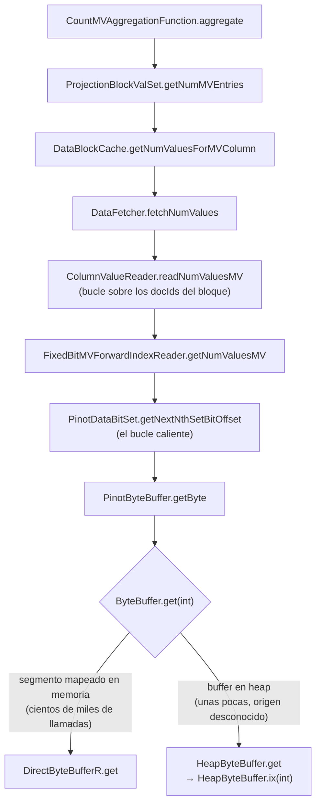
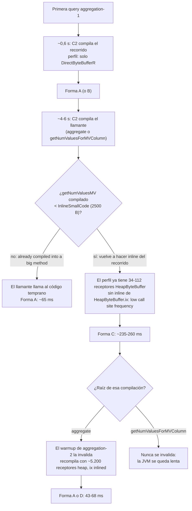

Esta es la segunda parte de [Seguir una corazonada ya sale barato](/blog/seguir-una-corazonada/).
Aquel post cuenta cómo Claude me ayudó a investigar una anomalía que, de otra forma, habría ignorado.
Este va de la anomalía en sí, con los números, el código, los comandos y el código máquina.
Es un post muy técnico que profundiza en partes de la JVM que muy pocos desarrolladores tocan y,
siendo sinceros, yo tampoco las había tocado.

> [!WARNING]
> **¡Aviso!** Este post contiene trazas de ensamblador.

Todos estos descubrimientos los hizo Claude Opus 5.5 de manera autónoma tras pedirle yo que indagase
más sobre el origen de la varianza entre ejecuciones.
En la práctica esto no era necesario.
Claude ya había encontrado una optimización que solucionaba el problema y acababa con la varianza,
pero me interesaba saber a qué era debida.
Puedo decir con algo de orgullo que esta vez mi corazonada _ingenieril_ era correcta y Claude la validó.

La versión corta:

- Un benchmark de release decía que StarTree Pinot 0.17 ejecuta las queries con `countMV` un 40% más rápido que 0.16.
- La causa real era un bucle [cuadrático](https://es.wikipedia.org/wiki/Complejidad_temporal) en el lector de columnas multivalor, presente en las dos versiones.
- La velocidad de ese bucle depende de cómo lo compile C2, el [compilador JIT](https://es.wikipedia.org/wiki/Compilaci%C3%B3n_en_tiempo_de_ejecuci%C3%B3n) optimizador de [HotSpot](https://en.wikipedia.org/wiki/HotSpot_(virtual_machine)), y C2 lo compila de al menos cuatro formas distintas.
  La forma depende de carreras y umbrales durante los primeros segundos de la JVM, así que el mismo binario en la misma JVM ejecuta la query en 43 ms o en 260 ms.
- El benchmark midió un arranque de JVM por versión, así que midió una sola tirada del dado.

## El resultado que no tenía sentido

La certificación de cada release ejecuta varias suites de queries contra un cluster, una versión detrás de otra, con el mismo hardware y los mismos datos.
Cada query se ejecuta durante 120 segundos con un cliente y sin pausas.
La latencia media de esa ejecución es una muestra, y hay tres pasadas medidas por versión.
Un [t-test de Welch](https://en.wikipedia.org/wiki/Welch%27s_t-test) (una variante de la [prueba t de Student](https://es.wikipedia.org/wiki/Prueba_t_de_Student)) decide qué cambios son significativos: dice si dos series de medidas se diferencian más de lo que explica su ruido.
La [corrección de Bonferroni](https://es.wikipedia.org/wiki/Correcci%C3%B3n_de_Bonferroni) hace más estricto el umbral, porque el benchmark prueba 65 queries a la vez, y algunas parecerían significativas por pura casualidad.

Entre 0.17 y 0.16, esta query de la suite de eventos de GitHub fue el cambio más grande:

```sql
SELECT count(*), countMV(commit_author_names), countMV(label_ids) FROM github_events
```

| Versión | Pasada 1 | Pasada 2 | Pasada 3 |
|---|---|---|---|
| 0.16 (Java 21) | 141,89 ms | 141,64 ms | 141,88 ms |
| 0.17 (Java 25) | 85,46 ms | 85,47 ms | 86,12 ms |

Un −39,6%, con un [valor p](https://es.wikipedia.org/wiki/Valor_p) de unos 1,3 × 10⁻⁶: si las dos versiones fueran en realidad iguales, una diferencia así casi nunca aparecería por casualidad.
La varianza dentro de cada versión es minúscula, así que el test está muy seguro.
Nadie en el equipo pudo señalar un cambio que lo explicara.

Otras dos queries de la misma suite también mejoraron (−22% y −10%), y una empeoró un 34%.
Vuelvo a ellas al final.

## Reproducirlo en casa

El primer paso fue sacar el resultado del cluster compartido y llevarlo a una máquina donde pudiéramos cambiar una cosa cada vez.
Claude montó un cluster pequeño en Docker en la máquina que tengo en casa para compilar:

- ZooKeeper y un controller con la imagen de 0.16, que se quedan arrancados todo el tiempo.
- Un broker y un server que se recrean para cada variante, con el server limitado a 6 CPUs (las mismas que en el cluster de certificación) y 12 GB de heap.
- El mismo dataset público que el benchmark: cuatro horas de eventos de [GH Archive](https://www.gharchive.org/), 546.496 filas en cuatro segmentos, generados con la imagen de 0.16 para que las dos versiones lean los mismos ficheros.
- Un pequeño driver en Python que ejecuta una query en bucle cerrado, como el cliente del benchmark.

La variable interesante es el JDK.
0.17 necesita Java 25, mientras que 0.16 funciona (casi) indistintamente en Java 21 y 25.
Así que Claude copió el JDK de la imagen de 0.17 y lo montó en el contenedor de 0.16.
Supongo que podría haber reconstruido la imagen de Docker cambiando la imagen base, pero
parece que ese día el agente estaba inspirado a probar cosas nuevas.

La matriz ejecutó tres variantes (0.16 con Java 21, 0.16 con Java 25 y 0.17 con Java 25), intercaladas, dos veces.
Esa decisión de diseño, dos rondas intercaladas en vez de una, es la que salvó la investigación, como vas a ver.

## La JVM parecía culpable, y luego no

La prueba cruzada: el mismo binario de 0.16, con Java 25 en vez de 21.

| Ronda | 0.16 con Java 21 | 0.16 con Java 25 | 0.17 con Java 25 |
|---|---|---|---|
| 1 | 232 ms | 140 ms | 73 ms |
| 2 | 237 ms | 68 ms | 64 ms |

Tras la ronda 1, la historia era limpia: Java 25 da un 40%, y 0.17 añade algo más.
La ronda 2 la rompió.
La misma variante, 0.16 con Java 25, pasó de 140 ms a 68 ms.
Entre rondas no cambió nada, salvo que el servidor se reinició.

Así que Claude repitió más arranques de JVM por variante, cada uno con el mismo warmup (todas las queries de la suite durante 20 segundos) antes de medir:

| Variante | aggregation-1, media por arranque de la JVM |
|---|---|
| 0.16 con Java 21 | 232, 237, **68**, 240, 235, 187, 69 ms |
| 0.16 con Java 25 | 140, **68**, 185, **68**, 235, **46**, **46** ms |
| 0.17 con Java 25 | de 62 a 73 ms, en los siete arranques |

Los dos JDK son [multimodales](https://en.wikipedia.org/wiki/Multimodal_distribution): sus resultados se agrupan alrededor de varios valores distintos en vez de uno.
Java 25 cayó en un modo rápido más veces en esta muestra, pero con siete arranques no es una prueba estadística demasiado sólida.
Y 0.17 fue rápida siempre, lo que seguía necesitando una explicación.

Esto también explica el resultado de la certificación.
El benchmark despliega una versión una vez y ejecuta sus tres pasadas en esa misma JVM.
Las tres muestras comparten un estado del JIT, así que coinciden entre sí, y el t-test ve una varianza minúscula.
Es [pseudo-replicación](https://en.wikipedia.org/wiki/Pseudoreplication): tres medidas de una sola muestra, tratadas como si fueran tres muestras independientes.
Los 142 ms de 0.16 son uno de sus modos intermedios, y los 86 ms de 0.17 son su modo rápido habitual.

## Primer vistazo: async-profiler

La primera herramienta fue [async-profiler](https://github.com/async-profiler/async-profiler), conectado al server dentro del contenedor mientras el driver ejecutaba `countMV(label_ids)` en bucle, usando la opción
`--ann`, que añade un sufijo a cada frame de Java: `_[j]` para un frame compilado y `_[i]` para uno [inlined](https://en.wikipedia.org/wiki/Inline_expansion).
En todos los arranques, casi todas las muestras estaban en el recorrido del bitmap, totalmente inlined.
Pero el frame que se llevaba el tiempo propio cambiaba:

| Arranque | `countMV(label_ids)` | Frame con el tiempo propio |
|---|---|---|
| 0.16, Java 21 (rápido) | 31 ms | `getNumValuesMV_[i]` (94%) |
| 0.16, Java 25 (lento) | 86 ms | `getNumValuesMV_[i]` (97%) |
| 0.16, Java 25 (rápido) | 23 ms | `getNextNthSetBitOffset_[i]` (97%) |
| 0.17, Java 25 | 30 ms | `MemorySessionImpl.checkValidStateRaw_[i]` (82%) |

Esa tabla muestra que el código compilado cambia de un arranque a otro.
No muestra cómo, y la última fila resultó ser engañosa, como veremos.
Dentro de un método compilado grande, con muchos frames inlined, el profiler asigna cada dirección de muestra a un frame inlined a partir de información de depuración, y esa asignación es aproximada.
Esto es importante: para un método inlined no podemos distinguir si el tiempo se perdió en ese método, en algún método _ancestro_
(el que lo llamaba, el que llamaba al que lo llamaba, etc.) o incluso en algún método hermano (¡o sobrino!).

En este punto ya tenía lo necesario para el fix (cambiar el código para que fuera lineal en lugar de cuadrático).
Pero quería saber qué hacía el JIT, así que al día siguiente le pedí a Claude que lo averiguara bien.

## Mirando el código máquina

Claude hizo esta segunda parte con un subagente en segundo plano.
Le llevó unas dos horas y media, 28 arranques de JVM y ninguna ayuda mía.
Estas son las herramientas que usó, porque cada una resolvía un problema concreto.

**hsdis.** HotSpot solo imprime código máquina con el plugin desensamblador [hsdis](https://github.com/openjdk/jdk/tree/master/src/utils/hsdis), y los JDK de las imágenes no lo traen.
Claude lo compiló en un contenedor Debian a partir de los fuentes de OpenJDK de las versiones exactas del JDK, con el backend de Capstone enlazado de forma estática.

Esta es la clase de galimatías que pocos desarrolladores disfrutan haciendo y que una LLM puede hacer fácilmente:

```bash
git clone --depth 1 --branch 5.0.1 https://github.com/capstone-engine/capstone.git
cmake -S capstone -B capstone/build -DCMAKE_BUILD_TYPE=Release -DCAPSTONE_ARCHITECTURE_DEFAULT=OFF \
  -DCAPSTONE_X86_SUPPORT=ON -DBUILD_SHARED_LIBS=OFF -DCMAKE_POSITION_INDEPENDENT_CODE=ON
cmake --build capstone/build -j 8
curl -fsSLO https://raw.githubusercontent.com/openjdk/jdk21u/jdk-21.0.12-ga/src/utils/hsdis/hsdis.h
curl -fsSLO https://raw.githubusercontent.com/openjdk/jdk21u/jdk-21.0.12-ga/src/utils/hsdis/capstone/hsdis-capstone.c
gcc -O2 -shared -fPIC -I capstone/include -I capstone/include/capstone -I . \
  -I /jdk21/include -I /jdk21/include/linux \
  -DLIBARCH_amd64 -DCAPSTONE_ARCH=CS_ARCH_X86 -DCAPSTONE_MODE=CS_MODE_64 \
  -o hsdis-amd64.so hsdis-capstone.c capstone/build/libcapstone.a
cp hsdis-amd64.so jdk21/lib/
```

**El log de compilación.** [`-XX:+LogCompilation`](https://wiki.openjdk.org/display/HotSpot/LogCompilation+overview) escribe un XML con todas las compilaciones: cuándo ocurrieron, su tamaño, cada decisión de inlining con su motivo y el perfil de tipos que vio C2 en cada llamada virtual.
De ahí salieron la mayoría de las respuestas.

Esta es la clase de análisis que un humano no puede hacer a mano y, en su lugar, necesita de herramientas o scripts.
Por el contrario, una LLM puede hacerlo sin problemas (normalmente con ayuda de un script que puede generar ella misma).

**perf.** Para saber qué método compilado se ejecutaba de verdad durante la medida, Claude muestreó el server con [`perf`](https://perfwiki.github.io/main/) de Linux y asignó cada dirección de muestra a un método compilado con `jcmd <pid> Compiler.codelist`, que imprime el rango de direcciones de cada nmethod.

**Un efecto observador.** Las primeras ejecuciones también usaban `-XX:CompileCommand=print,...` para imprimir el ensamblador de los métodos relevantes.
Eso pareció cambiar el resultado: los arranques lentos se volvieron más raros (1 de 7 en vez de 5 de 7).
Imprimir ensamblador hace más lentos los hilos del compilador y, como vas a ver, los tiempos entre hilos del compilador son parte de la historia.
Las ejecuciones posteriores solo usaron `LogCompilation`, y son la evidencia más limpia.

## Cuatro formas del mismo bucle

En todos los arranques, entre el 90% y el 97% de las muestras de CPU del server estaban en un único método compilado, y entre el 73% y el 95% de esas, en un único bucle interno: el `while (true)` de `getNextNthSetBitOffset`, inlined en algún llamante.
Ese bucle salió de C2 con cuatro formas distintas, y la forma por sí sola predice la latencia en los 19 arranques que muestreó perf:

| Forma | Qué generó C2 para el recorrido | Instrucciones por byte | aggregation-1 | Arranques |
|---|---|---|---|---|
| D | Bucle contado, [desenrollado](https://en.wikipedia.org/wiki/Loop_unrolling) 4 veces, sin [safepoint poll](https://psy-lob-saw.blogspot.com/2015/12/safepoints.html) ni bounds check por byte | ~7 | 43-44 ms | 3 |
| A | Bucle compacto: poll, bounds check, carga del byte, carga de la tabla, comparación | 11-13 | 63-69 ms | 10 |
| B | La forma A, pero con el índice del bucle en un registro XMM | 13 | 140 ms | 1 |
| C | Comprobaciones de tipo, recargas de campos y [spills](https://en.wikipedia.org/wiki/Register_allocation) a la pila dentro del bucle | 35-38 | 234-261 ms | 5 |

La forma A es la que uno esperaría.
Todas las comprobaciones de tipo y las cargas de campos están fuera del bucle:

```text title="Forma A, 65,6 ms (0.16, Java 21)"
movq    0x458(%r15), %r8          ; página del safepoint poll
testl   %eax, (%r8)               ; poll
subl    %esi, %edx                ; n -= numBitsSet            28,6%
leal    1(%r9), %r8d              ; byteOffset + 1
movl    %r8d, %ebx
cmpl    %edi, %r8d                ; bounds check
jae     <fuera de rango>
movzbl  1(%rax, %r9), %r8d        ; carga el byte
movabsq $0x6a86a09b8, %r9         ; NUM_BITS_SET
movl    0x10(%r9, %r8, 4), %esi   ; numBitsSet = NUM_BITS_SET[byte]
cmpl    %edx, %esi                ;                            43,1%
jl      <bucle>
```

Los porcentajes son la parte de las muestras del método que cae en cada instrucción.
En x86, una muestra suele caer en la instrucción siguiente a la que se queda esperando, así que el `cmpl` caliente tras una carga significa "esperando a esa carga".

La forma C es la lenta.
En cada byte, recarga valores de la pila, carga el campo del buffer del bitset, comprueba su clase, carga el `ByteBuffer` interno, comprueba su clase, comprueba la sesión de memoria y el límite, y solo entonces carga el byte.
Este es un extracto de su bucle:

```text title="Forma C, 233,8 ms (0.16, Java 21), extracto"
mov     %r11d, 0x48(%rsp)         ; spill de n
mov     %r10d, 0x4c(%rsp)         ; spill de la referencia al PinotDataBitSet
...                               ; poll
mov     0x4c(%rsp), %r10d         ; recarga la referencia al bitset
mov     0xc(%r12,%r10,8), %ebx    ; carga PinotDataBitSet._dataBuffer
mov     0x8(%r12,%rbx,8), %edx    ; carga su clase
mov     0x48(%rsp), %r11d         ; recarga n
cmp     $0x1340000, %edx          ; ¿clase == PinotByteBuffer?
mov     0x10(%rcx), %ebx          ; carga PinotByteBuffer._buffer
mov     0x8(%r12,%rbx,8), %edi    ; carga su clase
cmp     $0x25de50, %edi           ; ¿clase == DirectByteBufferR? si no -> camino HeapByteBuffer
mov     0x24(%rsi), %ebx          ; carga la sesión de memoria del buffer
...                               ; comprobaciones del límite y de rango
movsbl  0x1(%rcx,%r8,1), %ecx     ; carga el byte
...                               ; consulta de la tabla y comparación, como en la forma A
```

La rama `HeapByteBuffer` de ese bucle contiene una llamada real, a `HeapByteBuffer.ix(int)`, y después vuelve a saltar dentro del bucle.

La forma D es la más rápida.
C2 convirtió el recorrido en un bucle contado con el límite del buffer como cota, lo partió en tramos de 4000 bytes ([loop strip mining](https://bugs.openjdk.org/browse/JDK-8186027)), movió el safepoint poll al bucle exterior de tramos, eliminó el bounds check por byte y lo desenrolló 4 veces.

La forma B es la A con un giro: el asignador de registros guarda el índice del bucle en `xmm3`, así que el índice pasa de un registro general a uno XMM y vuelta en cada iteración.
Ocurrió en un arranque de 19.
¿Por qué? ¡Ni idea! Los caminos del ~~señor~~ JIT son inescrutables.

## Cómo elige su forma cada arranque

Para seguir lo que viene hace falta saber quién llama a quién.
Esta es la pila de llamadas de `countMV`, de arriba abajo:



C2 compila esta pila en dos momentos.
Primero compila los métodos de abajo (`getNumValuesMV`, `readNumValuesMV`), con el resto de la pila inlined dentro.
Después compila los de arriba (`aggregate`, `getNumValuesForMVColumn`), y ahí puede volver a meter dentro todo lo de abajo.
El perfil de tipos de `ByteBuffer.get(int)` es uno solo, compartido por todos los que llaman a `PinotByteBuffer.getByte`.

El log de compilación explica cómo acabó cada arranque con su forma.
Es una cadena de tres sucesos en los primeros segundos de la JVM.

**1. La primera compilación es limpia.**
Durante la primera query `aggregation-1`, C2 compila el recorrido en unos 0,6 segundos.
En ese momento, el perfil de tipos de `ByteBuffer.get(int)`, dentro de `PinotByteBuffer.getByte`, solo ha visto a `DirectByteBufferR` como clase receptora. En Pinot esa clase se usa cuando se lee un segmento mapeado en memoria.
Un perfil [monomórfico](https://shipilev.net/blog/2015/black-magic-method-dispatch/) (una sola clase receptora) da un bucle limpio: la forma A, o una vez la B.

**2. Los métodos llamantes se compilan unos segundos después.**
En el paso 1, C2 compiló los métodos del recorrido, `getNumValuesMV` y `readNumValuesMV`, con `getNextNthSetBitOffset`, `PinotByteBuffer.getByte` y `ByteBuffer.get` inlined dentro.
Entre 4 y 6 segundos después, C2 compila métodos que están más arriba en la pila de llamadas: `CountMVAggregationFunction.aggregate` y `DataBlockCache.getNumValuesForMVColumn`.
Al compilarlos, C2 tiene que decidir si mantiene una llamada al recorrido ya compilado o si vuelve a hacer inline del recorrido entero dentro del llamante.
Cuando el método llamado ya tiene código compilado, C2 solo hace inline si ese código es más pequeño que `InlineSmallCode`, que vale por defecto 2500 bytes en los dos JDK.
En 0.16, el `getNumValuesMV` compilado existe en variantes de unos 2,5 KB y 3,6 KB, y `readNumValuesMV` en variantes de 960 B y 4,6 KB.
Cuál de ellas está vigente en ese momento depende de una condición de carrera entre los dos hilos del compilador C2.
Si las variantes pequeñas son las vigentes, C2 vuelve a hacer inline de todo el recorrido y lo compila con el perfil que hay en ese momento, que ya no es el del paso 1.
Si son las grandes, el log dice `already compiled into a big method`, el llamante mantiene la llamada y el recorrido se queda con la forma A del paso 1.

**3. El perfil ya no está limpio.**
Cuando llega esa segunda compilación, el perfil de `ByteBuffer.get` ha visto entre 34 y 112 llamadas con un receptor `HeapByteBuffer`, frente a unas 100.000 con `DirectByteBufferR`.
C2 hace inline de los dos receptores, pero en 6 de 7 puntos de llamadas no hace inline de `HeapByteBuffer.ix(int)`, con el motivo `low call site frequency`.
Eso deja una llamada real en el camino raro dentro del bucle, y el bucle sale con la forma C.



Hay un giro más.
Si la compilación con forma C tiene `aggregate` como raíz, una query posterior del warmup (`aggregation-2`) la marca como _not entrant_, y la recompilación al principio de la medida ve unos 5.200 receptores heap.
Con tantos, C2 hace inline de `ix` en todas partes, y el resultado es la forma A o la D.
Si la raíz es `getNumValuesForMVColumn`, nada la invalida nunca, y la JVM se queda lenta toda su vida.

¿Por qué una llamada en un camino raro afecta tanto al camino caliente?
No estoy seguro, porque las builds de JVM precompiladas no registran sus optimizaciones de bucles.
Una llamada dentro del cuerpo del bucle obliga a C2 a suponer que la memoria puede cambiar en cada iteración.
Así que no puede sacar del bucle las cargas de campos ni las comprobaciones de tipo que dependen de ellas.
Además, el código Java compilado no tiene registros preservados por el llamado, así que los valores que sobreviven a la llamada van a la pila, y el camino caliente los recarga en cada byte.
Eso encaja con los spills y recargas del extracto de la forma C.
En teoría esto podría confirmarse si usáramos una compilación propia del JDK en la que
activáramos las trazas de optimización de bucles.

## El orden del warmup decide el resultado

En casos como este, donde el inlining depende de lo que ha visto el perfil cuando se compilan los callers,
el orden del warmup importa.
Claude lo probó directamente, en 0.16 con Java 21:

| Warmup | Arranques | aggregation-1 | Forma |
|---|---|---|---|
| Por defecto: las 7 queries de la suite, `aggregation-1` primero | 5 | 234, 237, 68, 65, 69 ms | C, C, A, A, A |
| Solo `aggregation-1` | 3 | 261, 258, 259 ms | C, C, C |
| `aggregation-2` y `aggregation-4` primero, luego el orden por defecto | 2 | 43, 43 ms | D, D |

Con solo `aggregation-1`, la compilación con forma C nunca se invalida, y todos los arranques son lentos.
Con las otras queries primero, el perfil ya tiene unos 2.250 receptores heap cuando el recorrido se compila por primera vez.
Las primeras compilaciones son bimórficas con `ix` inlined, son grandes, los llamantes no vuelven a hacer inline de ellas, y la medida ejecuta la forma D: 43 ms, seis veces más rápido que los arranques lentos.

Es la misma lección que la discusión sobre el warmup del [primer post](/blog/seguir-una-corazonada/), ahora con números.
El código que genera el JIT depende del perfil, y el perfil depende de lo que se ejecutó antes.
Un benchmark que calienta con una sola query, o que da a cada query una JVM nueva, mide un estado del JIT que producción no ve nunca.

Los receptores `HeapByteBuffer` vienen de la propia query `aggregation-1`, en números pequeños.
Todavía no sé qué código llama ahí a `getByte` sobre un buffer en heap.

## Por qué 0.17 siempre era rápida

0.17 corre en el mismo Java 25 que la segunda variante de 0.16, y el recorrido es el mismo código Java.
La diferencia es un método inlined.

En 0.17, todas las compilaciones del recorrido hacen inline de `ScopedMemoryAccess.getByteInternal` y, dentro, de `MemorySessionImpl.checkValidStateRaw`.
Esa es la comprobación de que la memoria detrás de un buffer sigue viva, y solo se ejecuta cuando el buffer tiene una sesión de memoria.
En 0.16, con el mismo JDK, la rama de sesión no nula nunca se tomó en el perfil, así que C2 la eliminó.

La comprobación queda fuera del bucle caliente, así que no cuesta nada por byte.
Eso también significa que el frame `checkValidStateRaw` al que async-profiler echaba la culpa era un artefacto de cómo el profiler asigna direcciones dentro de código inlined.

Pero la comprobación hace más grandes los métodos compilados.
En 0.17, el `getNumValuesMV` compilado que contiene el recorrido ocupa entre 4,2 y 7,0 KB, siempre por encima de `InlineSmallCode`.
Así que, en el paso 2 de la cadena, los llamantes nunca vuelven a hacer inline del recorrido, y la medida siempre ejecuta el código temprano, limpio, con la forma A.
En los tres arranques de 0.17 de este experimento, los llamantes registraron `already compiled into a big method`.

Así que 0.17 es rápida por casualidad.
No puede llegar a la forma C, pero tampoco llegó a la forma D.
Mi primera sospecha fue que el código llamante había cambiado entre versiones, y no iba desencaminada: la decisión se toma en los llamantes, pero lo que cambió es el tamaño del método llamado.
Todavía no he comprobado por qué los buffers de 0.17 tienen una sesión de memoria.

## Qué cambiar en el benchmark

1. **Contar arranques de JVM, no pasadas.** Tres pasadas en una JVM son una muestra para cualquier cosa que dependa del JIT.
   Si un resultado importa, necesita varios arranques de JVM por versión, intercalados.
2. **Calentar como en producción.** Ejecutar todas las queries de la suite, en orden aleatorio, antes de medir.
   Después, medir las queries una a una.
   Reiniciar la JVM para cada query y calentarla únicamente con esa query da números estables,
   pero describen un estado del JIT al que producción nunca llega.
3. **Desconfiar de los resultados demasiado limpios.** Una varianza minúscula con una diferencia enorme es un motivo para mirar más de cerca.

## Preguntas abiertas

1. ¿Qué código llama a `PinotByteBuffer.getByte` sobre un buffer en heap durante `aggregation-1`?
   Eliminar esa contaminación, o dar al recorrido su propio sitio de llamada monomórfico, haría determinista a 0.16.
2. ¿Por qué los buffers de 0.17 tienen una sesión de memoria?
3. ¿Por qué algunas compilaciones bimórficas dan la forma D y otras la A, con el mismo perfil?
4. ¿Cuánto cuesta cada forma en ciclos por byte? Un `perf stat` por forma convertiría en medidas algunas de las inferencias de arriba.
5. ¿Qué decide la carrera entre los hilos de C2?
   La variante de 2,5 KB de `getNumValuesMV` es una recompilación tras una desoptimización que no hace inline de una de las dos llamadas a `getNextNthSetBitOffset`.
   No sé todavía qué orden de compilaciones lleva a una variante o a la otra.
6. ¿Dónde está exactamente el umbral?
   En un arranque lento, C2 hizo inline de un `getNumValuesMV` de 2576 B, por encima de los 2500 de `InlineSmallCode`.
   Sospecho que C2 compara solo el tamaño de las instrucciones, y que el log da el tamaño total del nmethod, pero no lo he comprobado.
7. ¿Por qué la compilación lenta tiene a veces `aggregate` como raíz y otras `getNumValuesForMVColumn`?
   De eso depende que el warmup la rescate o no.

Para responderlas hace falta volver a la máquina de benchmarks y sacar del log de compilación la secuencia exacta de compilaciones de cada arranque.

## Cómo se hizo

No escribí ninguno de los scripts de este post.
Claude montó el cluster, ejecutó los benchmarks, leyó el código, encontró el bug, escribió el fix y abrió el pull request.
Para el análisis del JIT, lanzó un subagente que trabajó durante unas dos horas y media: compiló hsdis, ejecutó 28 arranques de JVM, analizó los logs de compilación y las muestras de perf, y escribió un informe que separaba los hechos medidos de las inferencias.
Claude comprobó algunas de sus afirmaciones contra los logs originales e hizo un resumen
a partir del cual Claude y yo escribimos este post.
