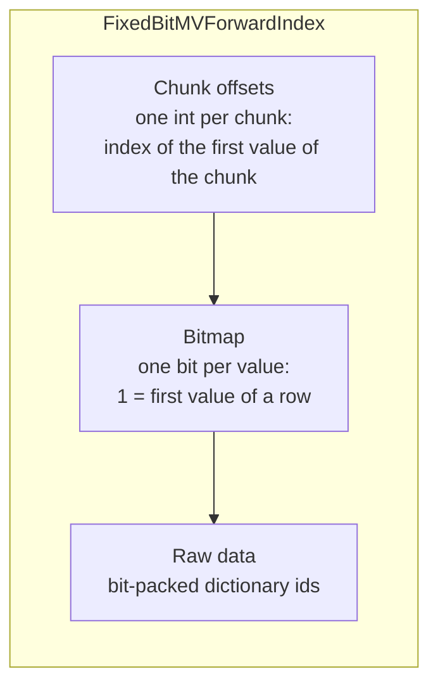
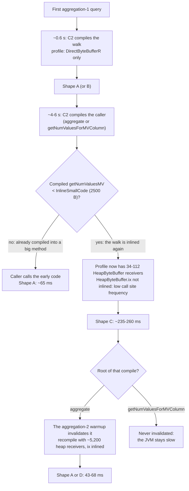

This is the technical half of [Following a hunch costs less now](/blog/following-a-hunch/).
That post is about how I used Claude to chase an anomaly that I would otherwise have ignored.
This one is about the anomaly itself, with the numbers, the code, the commands and the machine code.

The short version:

- A release benchmark said that StarTree Pinot 0.17 runs `countMV` queries about 40% faster than 0.16.
- The real cause was a [quadratic](https://en.wikipedia.org/wiki/Time_complexity) loop in the reader for multi-value columns, present in both versions.
- The speed of that loop depends on how C2, the optimizing [JIT compiler](https://en.wikipedia.org/wiki/Just-in-time_compilation) of [HotSpot](https://en.wikipedia.org/wiki/HotSpot_(virtual_machine)), compiles it, and C2 compiles it in at least four different ways.
  The shape depends on races and thresholds during the first seconds of the JVM, so the same binary on the same JVM runs the query in 43 ms or in 260 ms.
- The benchmark measured one JVM start per version, so it measured one roll of the dice.
- The fix is two lines.
  It makes the query take about 7 ms, whatever the JIT does.

## The result that did not make sense

Our release certification runs a set of query suites against a cluster, one version after the other, on the same hardware and the same data.
Each query runs for 120 seconds with one client and no think time.
The average latency of that run is one sample, and there are three measured passes per version.
A [Welch t-test](https://en.wikipedia.org/wiki/Welch%27s_t-test) decides which changes are significant: it tells whether two sets of measurements differ by more than their noise.
A [Bonferroni correction](https://en.wikipedia.org/wiki/Bonferroni_correction) makes the threshold stricter, because the benchmark tests 65 queries at once, and some of them would look significant by chance.

For 0.17 against 0.16, this query from the GitHub events suite was the biggest change:

```sql
SELECT count(*), countMV(commit_author_names), countMV(label_ids) FROM github_events
```

| Version | Pass 1 | Pass 2 | Pass 3 |
|---|---|---|---|
| 0.16 (Java 21) | 141.89 ms | 141.64 ms | 141.88 ms |
| 0.17 (Java 25) | 85.46 ms | 85.47 ms | 86.12 ms |

That is −39.6%, with a [p-value](https://en.wikipedia.org/wiki/P-value) of about 1.3 × 10⁻⁶: if both versions were really the same, a difference this big would almost never appear by chance.
The variance inside each version is tiny, so the test is very sure.
Nobody on the team could name a change that explains it.

Two other queries of the same suite also got faster (−22% and −10%), and one got 34% slower.
I come back to them at the end.

## Reproducing it at home

The first step was to get the result out of the shared cluster and into a box where we could change one thing at a time.
Claude built a small cluster in Docker on `galador`, my home build box:

- ZooKeeper and a controller on the 0.16 image, which stay up the whole time.
- A broker and a server that are recreated for each variant, with the server pinned to 6 CPUs (the same number as in the certification cluster) and a 12 GB heap.
- The same public dataset as the benchmark: four hours of [GH Archive](https://www.gharchive.org/) events, 546,496 rows in four segments, built with the 0.16 image so that both versions read the same files.
- A small Python driver that runs one query in a closed loop, like the benchmark client.

The interesting variable is the JDK.
0.17 needs Java 25, but 0.16 runs fine on it.
So Claude copied the JDK out of the 0.17 image and mounted it into the 0.16 container:

```bash
c=$(docker create startree-pinot:2.211.9)
docker cp "$c:/usr/lib/jvm/java-25-openjdk" ./jdk25
docker rm "$c"

docker run ... \
  -v "$PWD/jdk25:/opt/jdk:ro" \
  -e JAVA_HOME=/opt/jdk \
  -e PATH=/opt/jdk/bin:/usr/local/bin:/usr/bin:/bin \
  startree-pinot:2.196.51 StartServer ...
```

The `PATH` line is not decoration.
The launch script of 0.16 runs `java -version` from the `PATH` to detect the JDK, and on Java 21 it adds `-XX:GCLockerRetryAllocationCount=100`, a flag that Java 25 rejects.
With only `JAVA_HOME` changed, the script detects 21, adds the flag, and the JVM 25 fails to start.

The matrix ran three variants (0.16 on Java 21, 0.16 on Java 25, 0.17 on Java 25), interleaved, twice.
That design decision, two interleaved rounds instead of one, is what saved the investigation, as you will see.

## A count that is slower than a sum

The first numbers for 0.16 on Java 21 already had something wrong in them:

| Query | Average |
|---|---|
| `SELECT countMV(label_ids) FROM github_events` | 105.6 ms |
| `SELECT minMV(label_ids), maxMV(label_ids), sumMV(label_ids), avgMV(label_ids), minMaxRangeMV(label_ids) FROM github_events` | 11.2 ms |

Five aggregations that read every value of `label_ids` took 11 ms.
One aggregation that only needs the number of values per row took ten times more.
So Claude went to the code that returns that number.

### How Pinot stores a dictionary-encoded multi-value column

A dictionary-encoded multi-value column has three parts in its [forward index](https://docs.pinot.apache.org/basics/indexing/forward-index):



Rows are grouped into chunks of about 2048 values.
To find where row `d` starts, the reader takes the offset of its chunk and then walks the bitmap until it has seen `d % docsPerChunk` set bits.
That walk is linear in the position of the row inside its chunk.
To avoid doing it for every row, the reader keeps a small `Context` with the last row it read and where that row ended.
If the next request is for the next row, it starts there, and the cost is O(1).

`getDictIdMV`, which returns the values of a row, does exactly that.
`getNumValuesMV`, which returns only how many values a row has, read the context but never updated it:

```java title="FixedBitMVForwardIndexReader.java (before the fix)" {2,6,19,24}
public int getNumValuesMV(int docId, Context context) {
  int contextDocId = context._docId;          // always -1: nobody writes it
  int contextEndOffset = context._endOffset;
  int startIndex;
  if (docId == contextDocId + 1) {
    startIndex = contextEndOffset;            // the O(1) path, only for docId 0
  } else {
    int chunkId = docId / _numDocsPerChunk;
    if (docId > contextDocId && chunkId == contextDocId / _numDocsPerChunk) {
      // Same chunk
      startIndex = _bitmapReader.getNextNthSetBitOffset(contextEndOffset + 1, docId - contextDocId - 1);
    } else {
      // Different chunk: walk the bitmap from the start of the chunk
      int chunkOffset = _chunkOffsetReader.getInt(chunkId);
      int indexInChunk = docId % _numDocsPerChunk;
      if (indexInChunk == 0) {
        startIndex = chunkOffset;
      } else {
        startIndex = _bitmapReader.getNextNthSetBitOffset(chunkOffset + 1, indexInChunk);
      }
    }
  }
  int endIndex = (docId == _numDocs - 1) ? _numValues : _bitmapReader.getNextSetBitOffset(startIndex + 1);
  return endIndex - startIndex;               // context._docId and _endOffset stay as they were
}
```

The walk itself is a byte loop with a lookup table for the number of set bits in each byte:

```java title="PinotDataBitSet.java"
public int getNextNthSetBitOffset(int bitOffset, int n) {
  int byteOffset = bitOffset / Byte.SIZE;
  int bitOffsetInFirstByte = bitOffset % Byte.SIZE;
  int firstByte = (_dataBuffer.getByte(byteOffset) << bitOffsetInFirstByte) & BYTE_MASK;
  int numBitsSet = NUM_BITS_SET[firstByte];
  if (numBitsSet >= n) {
    return bitOffset + NTH_BIT_SET[n - 1][firstByte];
  }
  while (true) {
    n -= numBitsSet;
    byteOffset++;
    int currentByte = _dataBuffer.getByte(byteOffset) & BYTE_MASK;
    numBitsSet = NUM_BITS_SET[currentByte];
    if (numBitsSet >= n) {
      return (byteOffset * Byte.SIZE) | NTH_BIT_SET[n - 1][currentByte];
    }
  }
}
```

Now the numbers.
Most rows of `label_ids` have no labels, and Pinot stores an empty multi-value row as one default value, so the column has about one value per row.
That gives about 2048 rows per chunk.
On average, a row sits in the middle of its chunk, so each call walks about 1024 bits, which is 128 bytes, one `getByte` at a time.
For 546,496 rows, that is about 70 million iterations of that loop, for one column, in one query.
With the context updated, each call reads one or two bytes.

So the bug explains why `countMV` is slow.
It does not explain why 0.17 is faster: this code is identical in both versions.

## The JVM looked guilty, then it did not

The cross-test came next: same 0.16 binary, Java 25 instead of 21.

| Round | 0.16 on Java 21 | 0.16 on Java 25 | 0.17 on Java 25 |
|---|---|---|---|
| 1 | 232 ms | 140 ms | 73 ms |
| 2 | 237 ms | 68 ms | 64 ms |

After round 1, the story was clean: Java 25 gives 40%, and 0.17 adds some more.
Round 2 broke it.
The same variant, 0.16 on Java 25, went from 140 ms to 68 ms.
Nothing changed between the rounds except that the server was restarted.

So Claude ran more JVM starts per variant, each one with the same warmup (every query of the suite for 20 seconds) before measuring:

| Variant | aggregation-1, average per JVM start |
|---|---|
| 0.16 on Java 21 | 232, 237, 68, 240, 235, 187, 69 ms |
| 0.16 on Java 25 | 140, 68, 185, 68, 235, 46, 46 ms |
| 0.17 on Java 25 | 62 to 73 ms, in all seven starts |

Both JDKs are [multimodal](https://en.wikipedia.org/wiki/Multimodal_distribution): their results cluster around several different values instead of one.
Java 25 landed in a fast mode more often in this sample, but with seven starts that proves nothing.
And 0.17 was fast every time, which still needed an explanation.

This also explains the certification result.
The benchmark deploys a version once and runs its three passes on that same JVM.
The three samples share one JIT state, so they agree with each other, and the t-test sees a tiny variance.
That is [pseudo-replication](https://en.wikipedia.org/wiki/Pseudoreplication): three measurements of one sample, treated as if they were three independent samples.
The 142 ms of 0.16 is one of its middle modes, and the 86 ms of 0.17 is its usual fast mode.

## First look: async-profiler

The first tool was [async-profiler](https://github.com/async-profiler/async-profiler), attached to the server inside the container while the driver ran `countMV(label_ids)` in a loop:

```bash
docker cp async-profiler-4.3-linux-x64 ghb-server:/tmp/ap
docker exec ghb-server /tmp/ap/bin/asprof -e cpu -i 1ms -d 30 --ann -o collapsed \
  -f /tmp/profile.collapsed <pid>
```

`--ann` adds a suffix to each Java frame: `_[j]` for a compiled frame and `_[i]` for an [inlined](https://en.wikipedia.org/wiki/Inline_expansion) one.
In every start, almost all the samples were in the bitmap walk, fully inlined.
But the frame that got the self time moved around:

| Start | `countMV(label_ids)` | Frame with the self time |
|---|---|---|
| 0.16, Java 21 (fast) | 31 ms | `getNumValuesMV_[i]` (94%) |
| 0.16, Java 25 (slow) | 86 ms | `getNumValuesMV_[i]` (97%) |
| 0.16, Java 25 (fast) | 23 ms | `getNextNthSetBitOffset_[i]` (97%) |
| 0.17, Java 25 | 30 ms | `MemorySessionImpl.checkValidStateRaw_[i]` (82%) |

That table shows that the compiled code is different from one start to the next.
It does not show how, and the last row turned out to be misleading, as we will see.
Inside a big compiled method with many inlined frames, the profiler maps each sample address to an inlined frame using debug information, and that mapping is approximate.

At this point I had what I needed for the fix.
But I wanted to know what the JIT was doing, so the next day I asked Claude to find out properly.

## Looking at the machine code

Claude ran the second part as a background subagent on galador.
It took about two and a half hours, 28 JVM starts, and no help from me.
These are the tools it used, because each one solved a concrete problem.

**hsdis.** HotSpot only prints machine code with the [hsdis](https://github.com/openjdk/jdk/tree/master/src/utils/hsdis) disassembler plugin, and the JDKs in the images do not ship it.
Claude built it in a Debian container from the OpenJDK sources of the exact JDK versions, with the Capstone backend linked statically:

```bash
git clone --depth 1 --branch 5.0.1 https://github.com/capstone-engine/capstone.git
cmake -S capstone -B capstone/build -DCMAKE_BUILD_TYPE=Release -DCAPSTONE_ARCHITECTURE_DEFAULT=OFF \
  -DCAPSTONE_X86_SUPPORT=ON -DBUILD_SHARED_LIBS=OFF -DCMAKE_POSITION_INDEPENDENT_CODE=ON
cmake --build capstone/build -j 8
curl -fsSLO https://raw.githubusercontent.com/openjdk/jdk21u/jdk-21.0.12-ga/src/utils/hsdis/hsdis.h
curl -fsSLO https://raw.githubusercontent.com/openjdk/jdk21u/jdk-21.0.12-ga/src/utils/hsdis/capstone/hsdis-capstone.c
gcc -O2 -shared -fPIC -I capstone/include -I capstone/include/capstone -I . \
  -I /jdk21/include -I /jdk21/include/linux \
  -DLIBARCH_amd64 -DCAPSTONE_ARCH=CS_ARCH_X86 -DCAPSTONE_MODE=CS_MODE_64 \
  -o hsdis-amd64.so hsdis-capstone.c capstone/build/libcapstone.a
cp hsdis-amd64.so jdk21/lib/
```

**The compilation log.** [`-XX:+LogCompilation`](https://wiki.openjdk.org/display/HotSpot/LogCompilation+overview) writes an XML file with every compilation: when it happened, its size, every inlining decision with its reason, and the type profile that C2 saw at each virtual call.
That is where most of the answers came from:

```text
-XX:+UnlockDiagnosticVMOptions -XX:+LogCompilation -XX:LogFile=/state/jit-%p.log
```


**perf.** To know which compiled method actually ran during the measurement, Claude sampled the server with Linux [`perf`](https://perfwiki.github.io/main/) and mapped each sample address to a compiled method with `jcmd <pid> Compiler.codelist`, which prints the address range of every nmethod.

**An observer effect.** The first runs also used `-XX:CompileCommand=print,...` to print the assembly of the relevant methods.
That seemed to change the result: slow starts became rarer (1 in 7 instead of 5 in 7).
Printing assembly makes the compiler threads slower, and, as you will see, the timing between compiler threads is part of the story.
The samples are small, so this is a plausible explanation, not a measured one.
The later runs only used `LogCompilation`, and they are the cleaner evidence.

## Four shapes of the same loop

In every start, 90-97% of all server CPU samples were in one compiled method, and 73-95% of those were in one inner loop: the `while (true)` of `getNextNthSetBitOffset`, inlined into some caller.
That loop came out of C2 in four different shapes, and the shape alone predicts the latency in all 19 starts that perf sampled:

| Shape | What C2 emitted for the byte walk | Instructions per byte | aggregation-1 | Starts |
|---|---|---|---|---|
| D | Counted loop, [unrolled](https://en.wikipedia.org/wiki/Loop_unrolling) 4x, no per-byte [safepoint poll](https://psy-lob-saw.blogspot.com/2015/12/safepoints.html) or bounds check | ~7 | 43-44 ms | 3 |
| A | Tight loop: poll, bounds check, byte load, table load, compare | 11-13 | 63-69 ms | 10 |
| B | Shape A, but the loop index lives in an XMM register | 13 | 140 ms | 1 |
| C | Type guards, field reloads and stack [spills](https://en.wikipedia.org/wiki/Register_allocation) inside the loop | 35-38 | 234-261 ms | 5 |

Shape A is what you would hope for.
All the type checks and field loads are hoisted out of the loop:

```text title="Shape A, 65.6 ms (0.16, Java 21)"
movq    0x458(%r15), %r8          ; safepoint poll page
testl   %eax, (%r8)               ; poll
subl    %esi, %edx                ; n -= numBitsSet            28.6%
leal    1(%r9), %r8d              ; byteOffset + 1
movl    %r8d, %ebx
cmpl    %edi, %r8d                ; bounds check
jae     <out of bounds>
movzbl  1(%rax, %r9), %r8d        ; load the byte
movabsq $0x6a86a09b8, %r9         ; NUM_BITS_SET
movl    0x10(%r9, %r8, 4), %esi   ; numBitsSet = NUM_BITS_SET[byte]
cmpl    %edx, %esi                ;                            43.1%
jl      <loop>
```

The percentages are the share of the method's samples on each instruction.
On x86 a sample usually lands on the instruction after the one that stalls, so the hot `cmpl` after a load means "waiting for that load".

Shape C is the slow one.
On every byte, it reloads values from the stack, loads the buffer field of the bitset, checks its class, loads the inner `ByteBuffer`, checks its class, checks the memory session and the limit, and only then loads the byte.
This is an excerpt of its loop:

```text title="Shape C, 233.8 ms (0.16, Java 21), excerpt"
mov     %r11d, 0x48(%rsp)         ; spill n
mov     %r10d, 0x4c(%rsp)         ; spill the PinotDataBitSet reference
...                               ; poll
mov     0x4c(%rsp), %r10d         ; reload the bitset reference
mov     0xc(%r12,%r10,8), %ebx    ; load PinotDataBitSet._dataBuffer
mov     0x8(%r12,%rbx,8), %edx    ; load its class
mov     0x48(%rsp), %r11d         ; reload n
cmp     $0x1340000, %edx          ; class == PinotByteBuffer ?
mov     0x10(%rcx), %ebx          ; load PinotByteBuffer._buffer
mov     0x8(%r12,%rbx,8), %edi    ; load its class
cmp     $0x25de50, %edi           ; class == DirectByteBufferR ? else -> HeapByteBuffer path
mov     0x24(%rsi), %ebx          ; load the buffer's memory session
...                               ; limit and bounds checks
movsbl  0x1(%rcx,%r8,1), %ecx     ; load the byte
...                               ; table lookup and compare, as in shape A
```

The `HeapByteBuffer` branch of that loop contains a real call, to `HeapByteBuffer.ix(int)`, and then jumps back into the loop.
Hold on to that detail.

Shape D is the fastest.
C2 turned the walk into a counted loop with the buffer limit as its bound, split it into strips of 4000 bytes ([loop strip mining](https://bugs.openjdk.org/browse/JDK-8186027)), moved the safepoint poll to the outer strip loop, removed the per-byte bounds check and unrolled it 4 times.
It appeared with Java 21 and with Java 25, so it is not specific to one JDK.

Shape B is shape A with a twist: the register allocator keeps the loop index in `xmm3`, so the index goes from a general register to an XMM register and back on every iteration.
It happened in one start out of 19.

## How a start picks its shape

The compilation log explains how each start ended up with its shape.
It is a chain of three events in the first seconds of the JVM.

**1. The first compile is clean.**
During the first `aggregation-1` query, C2 compiles the walk in about 0.6 seconds.
At that moment, the type profile at `ByteBuffer.get(int)`, inside `PinotByteBuffer.getByte`, has seen only one receiver class: `DirectByteBufferR`, the read-only view of the memory-mapped segment.
A [monomorphic](https://shipilev.net/blog/2015/black-magic-method-dispatch/) profile (one receiver class) gives a clean loop: shape A, or once shape B.

**2. The callers get compiled a few seconds later.**
After 4 to 6 seconds, C2 compiles the callers: `CountMVAggregationFunction.aggregate` or `DataBlockCache.getNumValuesForMVColumn`.
C2 inlines a callee that already has compiled code only if that code is smaller than `InlineSmallCode`, 2500 bytes on both JDKs.
On 0.16, the compiled `getNumValuesMV` that holds the walk exists in variants of about 2.5 KB and 3.6 KB, depending on a race between the two C2 compiler threads.
When the small variant is current, the caller inlines the whole walk again, and compiles it with the profile it sees now.
When it is not, the log says `already compiled into a big method`, the caller calls the early code, and the start stays in shape A.

**3. The profile is no longer clean.**
By the time of that second compile, the profile at `ByteBuffer.get` has seen 34 to 112 calls with a `HeapByteBuffer` receiver, against about 100,000 with `DirectByteBufferR`.
C2 inlines both receivers, but at 6 of 7 call sites it does not inline `HeapByteBuffer.ix(int)`, with the reason `low call site frequency`.
That leaves a real call on the rare path inside the loop, and the loop comes out as shape C.



There is one more twist.
If the shape-C compile has `aggregate` as its root, a later warmup query (`aggregation-2`) makes it not entrant, and the recompile at the start of the measurement sees about 5,200 heap receivers.
With that many, C2 inlines `ix` everywhere, and the result is shape A or D.
If the root is `getNumValuesForMVColumn`, nothing ever invalidates it, and the JVM stays slow for its whole life.

Why does a call on a rare path hurt the hot path so much?
This part is an inference, because a product JVM does not log its loop optimizations.
A call inside the loop body means that C2 must assume that memory can change on every iteration.
So it cannot hoist the field loads and the type checks that depend on them out of the loop.
Compiled Java code also has no callee-saved registers, so the values that live across the call get stack slots, and the hot path reloads them on every byte.
That matches the spills and reloads in the shape-C excerpt.
A fastdebug build of the JDK with the loop-optimization traces would confirm it.

## The warmup order decides the outcome

If the shape depends on what the profile has seen when the callers compile, the warmup order matters.
Claude tested that directly, on 0.16 with Java 21:

| Warmup | Starts | aggregation-1 | Shape |
|---|---|---|---|
| Default: the 7 queries of the suite, `aggregation-1` first | 5 | 234, 237, 68, 65, 69 ms | C, C, A, A, A |
| Only `aggregation-1` | 3 | 261, 258, 259 ms | C, C, C |
| `aggregation-2` and `aggregation-4` first, then the default order | 2 | 43, 43 ms | D, D |

With only `aggregation-1`, the shape-C compile is never invalidated, and every start is slow.
With the other queries first, the profile already has about 2,250 heap receivers when the walk is compiled for the first time.
The first compiles are bimorphic with `ix` inlined, they are big, the callers do not re-inline them, and the measurement runs shape D: 43 ms, six times faster than the slow starts.

This is the same lesson as the warmup discussion in the [first post](/blog/following-a-hunch/), now with numbers.
The code that the JIT generates depends on the profile, and the profile depends on what ran before.
A benchmark that warms up with one query, or that gives every query a fresh JVM, measures a JIT state that production never sees.

The `HeapByteBuffer` receivers come from the `aggregation-1` query itself, in small numbers.
I do not know yet which code calls `getByte` on a heap buffer there.

## Why 0.17 was always fast

0.17 runs on the same Java 25 as the second 0.16 variant, and the walk is the same Java code.
The difference is one inlined method.

In 0.17, every compile of the walk inlines `ScopedMemoryAccess.getByteInternal` and, inside it, `MemorySessionImpl.checkValidStateRaw`.
That is the check that the memory behind a buffer is still alive, and it only runs when the buffer has a memory session.
In 0.16 on the same JDK, the branch for a non-null session was never taken in the profile, so C2 dropped it.

The check is hoisted out of the hot loop, so it costs nothing per byte.
That also means that the `checkValidStateRaw` frame that async-profiler blamed earlier was an artifact of how the profiler maps addresses inside inlined code.

But the check makes the compiled methods bigger.
In 0.17, the compiled `getNumValuesMV` that holds the walk is 4.2 to 7.0 KB, always above `InlineSmallCode`.
So in step 2 of the chain, the callers never inline the walk again, and the measurement always runs the early, clean, shape-A code.
In all three 0.17 starts of this experiment, the callers logged `already compiled into a big method`.

So 0.17 is fast by accident.
It cannot reach shape C, but it did not reach shape D either.
My first guess was that the calling code changed between versions, and that was close: the decision happens at the callers, but what changed is the size of the callee.
I have not checked yet why the buffers of 0.17 have a memory session at all.

## The fix

With the context updated, the walk for each row is one or two bytes, and the shape of the loop stops mattering:

```diff lang="java"
       endIndex = _bitmapReader.getNextSetBitOffset(startIndex + 1);
     }
+    context._docId = docId;
+    context._endOffset = endIndex;
     return endIndex - startIndex;
```

| Variant | aggregation-1 |
|---|---|
| 0.16 on Java 21, before | about 65 to 260 ms, depending on the JVM start |
| 0.16 on Java 25, before | about 44 to 235 ms |
| 0.16 on Java 21, with the fix | 7.9 and 7.5 ms |
| 0.16 on Java 25, with the fix | 7.3 and 7.2 ms |

`countMV(label_ids)` alone went from 23-109 ms to about 5 ms.

The fix is not a new idea.
`getDictIdMV` in the same class and `recordDocIdByteRanges` already update the context in exactly this way.
`getNumValuesMV` simply forgot to.
The pull request is [apache/pinot#19992](https://github.com/apache/pinot/pull/19992), with a test that mixes `getNumValuesMV` and `getDictIdMV` calls on one context in sequential, skipping and random order.
It is merged, and we backported it to the 0.17 line.

## The other queries in the report

The same release report had three other significant changes in this suite.

Two of them are real.
`aggregation-4` (`distinctCount` and `distinctCountMV` on several columns) was 22% faster, and `aggregation-2` (`minMV`, `maxMV`, `sumMV` and others) 10% faster.
They come from [apache/pinot#18334](https://github.com/apache/pinot/pull/18334), which is only in 0.17.
Before it, Pinot answered aggregations from the dictionary or the column metadata only when every aggregation of the query could use that path.
Now it resolves each one that can, and scans only for the others.
In the local cluster, `aggregation-4` went from about 112 ms to 82 ms, consistently.

The third one, a regular-expression query that was 34% slower, looks like more of the same JIT noise.
Locally it moved between 198 and 299 ms on both versions, with no trend.

## What to change in the benchmark

1. **Count JVM starts, not passes.** Three passes on one JVM are one sample for anything that depends on the JIT.
   If a result matters, it needs several JVM starts per version, interleaved.
2. **Warm up like production.** Run all the queries of the suite, in random order, before measuring.
   Then measure the queries one by one.
   Restarting the JVM for every query gives stable numbers, but they describe a JIT state that production never reaches.
3. **Distrust results that are too clean.** A tiny variance with a huge difference is a reason to look closer, not a reason to celebrate.

## Open questions

1. Which code calls `PinotByteBuffer.getByte` on a heap buffer during `aggregation-1`?
   Removing that pollution, or giving the walk its own monomorphic call site, would make 0.16 deterministic.
2. Why do the buffers of 0.17 have a memory session?
3. Why do some bimorphic compiles give shape D and others shape A, with the same profile?
4. How much does each shape cost in cycles per byte? `perf stat` per shape would turn some of the inferences above into measurements.

## How this was done

I did not write any of the scripts in this post.
Claude built the cluster, ran the benchmarks, read the code, found the bug, wrote the fix and opened the pull request.
For the JIT analysis, it started a subagent that worked on galador for about two and a half hours: it built hsdis, ran 28 JVM starts, parsed the compilation logs and the perf samples, and wrote a report that separated measured facts from inferences.
Claude checked a few of its claims against the raw logs, I read it, and we wrote this post from it.
The decisions about what to measure, and why, were still mine.
