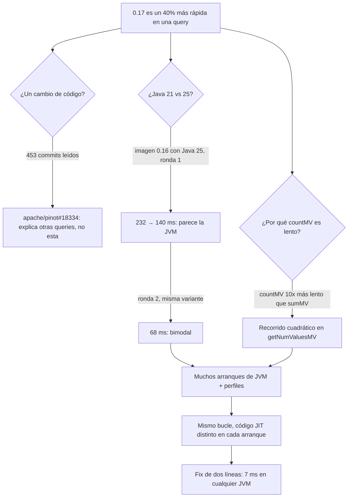

## Intro excesivamente larga y filosófica

No pasa un día sin que aparezcan noticias sobre el impacto de la IA, algunas más 
fatalistas que otras. Hay quien dice que la IA acabará con el trabajo tal cual lo 
conocemos. Algunos opinan que viviremos en un mundo solar-punk donde el trabajo sea 
opcional o trabajemos muy pocas horas. Otros ven más probable un futuro más oscuro 
donde el desempleo sea masivo. Están también aquellos que piensan que, tal como ha 
hecho en el pasado, el mercado se ajustará solo y el aumento de productividad nos 
permitirá generar muchos nuevos nichos que explotar y por tanto seguiremos trabajando 
lo mismo, pero produciendo y consumiendo más.

La verdad es que, en este amplio espectro, no sé realmente dónde colocarme.
Lo que sí que experimento cada día es que la IA hace mi trabajo mucho más productivo,
permitiendo centrarme en lo importante y solventando problemas de formas que no 
podría haber imaginado.
Precisamente me gustaría hablar de eso en el primer post de este blog.

## El meollo

En StarTree, donde trabajo, tenemos nuestra propia distribución de Apache Pinot, a 
la que añadimos una serie de extensiones propietarias. 
Además hacemos nuestras propias releases que no siguen la cadencia de Apache Pinot.
Si bien en Apache Pinot estamos pensando en lanzar la versión 1.6.0, en StarTree Pinot 
estamos haciendo pruebas de rendimiento a la versión 0.17, que se deriva de algún commit 
de Apache Pinot cercano al de 1.6.0.

Durante estas pruebas vimos que algunas queries eran significativamente más rápidas en 
0.17 que en 0.16.
Entre ellas, había una query que destacaba:

```sql
SELECT 
  count(*), 
  countMV(commit_author_names),
  countMV(label_ids)
FROM github_events
```

En 0.17 era casi un 40% más rápida: 142 ms antes, 86 ms después.
Un cambio tan significativo de rendimiento normalmente es debido a un cambio en el código.
El problema es que ninguno de los committers del motor de queries teníamos ni idea de qué 
podía haber hecho más rápida esa query.
Nada en la release tocaba `countMV`, y la query es de las agregaciones más simples que se pueden escribir.

Si esto hubiera pasado hace unos años, seguramente lo habríamos tomado como una buena noticia.
Tal vez mosquease un poco a alguien y dedicase algo de tiempo para ver qué ocurría, pero la prioridad 
sería baja.
El equipo tiene otras muchas tareas en las que trabajar y explicar una mejora de rendimiento en una función de agregación 
que raramente se usa no parecía algo tan importante en este momento.
Además, da la casualidad de que 0.16 corre en Java 21 mientras que 0.17 corre en Java 25, así que 
teníamos el cambio de Java como justificante teórico. 
¡Seguro que la causa sería alguna optimización de JIT o GC en la nueva versión de Java!

Pero... ¿qué pasa si el ingeniero le encarga a una IA como Opus 5.5 que investigue el asunto?
Este post cuenta lo que pasó cuando, en vez de encogerme de hombros, le dediqué un prompt.

## El prompt

Este es el prompt que le di a Claude Code:

> Estamos haciendo unas pruebas comparando el rendimiento de StarTree Pinot 0.16 con 0.17.
> El resultado de las pruebas está en este informe (link). Una de las más significativas es github events query aggregation-1. [...]
> Esta query es casi un 40% más rápida en la nueva versión. Los expertos en el motor de queries no sabemos de dónde puede venir tal mejora y creemos que es ruido o algo situacional.
> Quiero que estudies qué puede estar pasando. Puedes usar `galador`, donde puedes hacer `docker pull` para obtener las imágenes.
> También puedes compilar el código de las distintas ramas por tu cuenta o usar async-profiler o la skill para hacer debug de Java.
> Mira también si alguna config es diferente entre versiones. [...]
> Un cambio que existe seguro es que 0.16 y 0.17, en Docker, usan distintas versiones de Java (21 para 0.16 y 25 para 0.17).

Esa fue toda la dirección que recibió. 
Probablemente fui demasiado específico.
Claude podría inferir gran parte de las ideas que le había dado, pero quería favorecer que cargase las distintas 
skills que ya tenía configuradas.[^skills]
Nombré al sospechoso en el que yo creía (la JVM), le di una máquina[^galador] y le dejé trabajar.


## Qué hizo Claude y cuánto tardó

No estuve mirando la investigación.
Tenía otras tareas más prioritarias que atender.
A los 45 minutos, Claude ya había montado el cluster y había encontrado que, por error, el código tenía coste cuadrático en lugar de lineal.
A la hora y cuarto, ¡ya había desmontado mi teoría de la JVM!
Es cierto que tardó unas 3 horas en total en verificar sus hallazgos, principalmente por querer ser exhaustivo y
arrancar distintas JVMs múltiples veces, pero durante todo ese tiempo pude dedicarme a otras tareas más prioritarias.

Esta es la cronología, medida a partir de la sesión:

| Tiempo | Qué pasó |
|---|---|
| 0:00 | Prompt. Claude lee el informe, localiza las builds exactas y lista los 453 commits open source entre las dos versiones. |
| ~0:20 | Encuentra un cambio real, apache/pinot#18334, que permite a Pinot resolver algunas agregaciones desde el diccionario sin escanear. Explica otras dos queries más rápidas, pero no esta. |
| ~0:30 | Crea un cluster local en galador: ZooKeeper, controller, broker y server en Docker, con el mismo dataset público (546.496 filas) y un servidor con 6 CPUs, como en el benchmark. |
| ~0:45 | Los primeros números de 0.16 muestran algo raro: contar los valores de una columna es diez veces más lento que sumarlos. Claude lee el código y encuentra un bucle cuadrático. |
| ~0:50 | La prueba cruzada clave: la imagen de 0.16 con Java 25 montado. La query pasa de 232 ms a 140 ms, el mismo 40%. Parece que mi corazonada era buena. |
| ~1:15 | La segunda ronda de la misma matriz: 0.16 con Java 25 ahora tarda 68 ms. El resultado es bimodal. La historia de "es Java 25" se cae. |
| ~1:50 | Perfiles de varios arranques de la JVM: el mismo bucle se lleva todo el tiempo en cada arranque, pero el JIT lo compila distinto cada vez. |
| ~3:25 | Confirmado con siete arranques de JVM por variante y un parche de dos líneas: la query baja a unos 7 ms, con Java 21 y con Java 25. |
| +0:20 | El fix es un pull request a Apache Pinot. |

Este es el recorrido de la investigación, con sus callejones sin salida:



Casi todas esas tres horas y media fueron benchmarks corriendo en segundo plano en galador.
Gastaron mucha CPU y memoria durante bastante tiempo, pero en otra máquina, así que ni mi portátil ni mi día se vieron afectados.
No tuve que vigilar un cluster de Docker ni tener una terminal abierta (bueno, sí, ¡pero porque es en la terminal donde corre Claude Code!).
Además, suelo tardar en contestar a Claude cuando la tarea tiene poca prioridad, como esta.
Aquí daba igual: la investigación no necesitó ninguna respuesta mía hasta el final.

## La parte en la que mi corazonada fallaba

Hay dos momentos de esa cronología que importan más que el resto.

El primero es en el 0:45.
En los primeros números de 0.16, sobre la misma columna, `countMV(label_ids)` tardaba 105 ms y `sumMV(label_ids)` 11 ms.
Contar valores era diez veces más lento que sumarlos.
Si acaso eso debería ser al revés: contar debería ser más rápido que sumar.
Claude entendió eso, así que leyó el código del lector.
En Pinot, `getNumValuesMV`, el método que devuelve cuántos valores tiene una fila, lee la posición actual de un contexto 
del lector pero nunca la vuelve a escribir.
Su hermano, `getDictIdMV`, sí actualiza el contexto.
Este es el método antes del fix, simplificado:

```java title="FixedBitMVForwardIndexReader.java" {9-11,13-14,18-19}
/// Context es un objeto que lleva, entre otras cosas, la posición actual de lectura.
/// A veces al leer podemos saltarnos posiciones por razones que no vienen a cuento.
/// Por eso el código tiene un if para el caso secuencial y rápido, y otro para el que
/// salta filas. Como para saber dónde empieza una fila hay que contar bits en un bitmap,
/// saltar filas tiene un coste lineal con el salto.
public int getNumValuesMV(int docId, Context context) {
  int startIndex;
  // por razones históricas, Pinot llama `docId` a _la fila_
  if (docId == context._docId + 1) {
    // Siguiente doc: O(1). Nunca se usa, porque el contexto no avanza.
    startIndex = context._endOffset;
  } else {
    // Cualquier otro doc: recorre el bitmap byte a byte para saber dónde empieza.
    startIndex = _bitmapReader.getNextNthSetBitOffset(chunkOffset + 1, indexInChunk);
    // (simplificado: también hay una variante "mismo chunk" de este recorrido)
  }
  int endIndex = _bitmapReader.getNextSetBitOffset(startIndex + 1);
  // antes del return deberíamos actualizar context._docId para que la siguiente lectura
  // sea secuencial, ¡pero no lo hacemos!
  return endIndex - startIndex;
}
```

Sin esa actualización, cada fila empieza de nuevo a recorrer byte a byte un bitmap desde 
el inicio de su chunk, así que el coste por chunk es cuadrático.
`async-profiler` lo confirmó después: casi todo el tiempo de CPU estaba en ese recorrido.

Eso explicaba por qué la query era lenta, pero no por qué 0.17 era más rápida.
La prueba cruzada del 0:50 parecía responderlo: el mismo código de Pinot (ST 0.16), solo 
cambia la JVM, y la query es un 40% más rápida.
Habría sido el sitio perfecto para parar y escribir "confirmado, es la JVM" en el hilo de la release.
Alguien podría pensar que Java 25 es especialmente bueno en casos como este y es capaz de 
optimizar el código de alguna forma para reducir el coste de este trabajo cuadrático.

El segundo momento es en el 1:15.
Lo cierto es que la JVM es muy buena, pero no tanto.
El benchmark ejecutaba cada variante dos veces, intercaladas, y la segunda ejecución de la misma variante dio otra respuesta: 68 ms en vez de 140 ms.
Claude no intentó explicar la diferencia como ruido.
La trató como el dato más interesante hasta ese momento, perfiló varios arranques de la JVM y repitió más arranques de cada variante.

Estos son los resultados, con el mismo binario y el mismo warmup en cada arranque:

| Variante | Latencia de la query por arranque de la JVM (ms) |
|---|---|
| 0.16 con Java 21 | 232, 237, 68, 240, 235, 187, 69 |
| 0.16 con Java 25 | 140, 68, 185, 68, 235, 46, 46 |
| 0.17 con Java 25 | entre 62 y 73 en los siete arranques |
| 0.16 con el fix | 7,9 y 7,5 (Java 21); 7,3 y 7,2 (Java 25) |

El mismo binario, en la misma JVM, puede ser cinco veces más rápido o más lento según cómo compile el JIT ese bucle en ese arranque.
El benchmark de la release desplegó cada versión una vez y ejecutó sus tres pasadas en la misma JVM, así que midió una sola tirada de ese dado por versión.
Por eso la varianza parecía minúscula.

Los detalles, con los perfiles y un análisis de lo que hace el JIT en cada caso, irán en un próximo post.

## El fix que nadie habría priorizado

El fix ([apache/pinot#19992](https://github.com/apache/pinot/pull/19992)) son dos líneas:

```diff lang="java"
       endIndex = _bitmapReader.getNextSetBitOffset(startIndex + 1);
     }
+    context._docId = docId;
+    context._endOffset = endIndex;
     return endIndex - startIndex;
```

No tiene nada de ingenioso.
El método de al lado ya hacía exactamente esto.
La query pasó de 46–240 ms, según el arranque de la JVM, a 7 ms.

Mi apuesta es que `getNumValuesMV` empezó como una copia de la lógica de búsqueda, y el último paso se perdió por el camino.
Es el tipo de olvido que no detecta una review, porque el código parece completo, ni un test, porque el 
resultado es correcto.
Al menos para un humano.
Probablemente una IA haciendo de revisor podría haber encontrado el problema.
El PR que introdujo esta funcionalidad, [apache/pinot#8953](https://github.com/apache/pinot/pull/8953), modificaba casi 3.000 líneas de código.
Y, como curiosidad, ese mismo PR sí actualiza el contexto en el método de justo encima.
Una revisión así puede ser pesada para un humano, pero no es nada para una IA a la que se pide 
que mida la corrección pero también el rendimiento.

Quiero dejar clara una cosa.
Mi equipo podría haber encontrado esto.
Hubiera sido fácil montar un cluster y replicar el benchmark con `async-profiler` activado.
Tal vez se nos hubiera escapado el probar con distintas JVMs para detectar el cambio de tiempos según la _lotería_ del JIT,
pero no tengo duda de que hubiéramos encontrado el bug de rendimiento.
La pregunta es cuántas otras cosas más útiles podríamos haber estado haciendo en ese tiempo.
Además `count` sobre una columna multivalor es un operador no tan usado, la "regresión" era una mejora y siempre hay algo más urgente.
Sin una forma barata de investigar, esto se habría quedado en "seguramente es la JVM" para siempre, y el bucle cuadrático seguiría ahí.
Tal vez en un tiempo, al correr el mismo benchmark para 0.18, por casualidades de la vida JIT compilaría la versión cara y entonces 
la prioridad sí sería dedicarle más tiempo a la _regresión_.

## Donde corregí a Claude

Claude no acertó en todo, y el sitio donde se equivocó es interesante.

Para entenderlo, hay que saber cómo funciona nuestro benchmark.
Cada versión se despliega una vez.
Después se ejecutan tres pasadas sobre la misma JVM, y en cada pasada cada query se ejecuta en ráfaga durante 120 segundos.
Como las tres pasadas comparten la misma compilación JIT, sus tiempos se parecen mucho entre sí, aunque esa compilación haya salido especialmente buena o mala.

Claude recomendó reiniciar los servidores entre pasadas, para que cada pasada fuera una muestra independiente del JIT.
Estadísticamente tiene razón, pero no es lo que buscamos.
Este benchmark no está pensado para medir la lotería del JIT.
Está pensado para detectar regresiones en nuestros cambios, con números que se parezcan a los de producción.

Un servidor en producción no ejecuta una query en una JVM recién arrancada.
Ejecuta una mezcla de queries, y el JIT compila el código compartido con esa mezcla en sus perfiles.
Si el JIT solo ve una query, puede especializar el código para ella, y en general esos números serán mejores que los de producción.
No siempre: en este caso, calentar solo con la query lenta dio los peores tiempos de todos, como cuento en el siguiente post.
En cualquier caso, describen un estado del JIT que producción no ve.

Así que hay dos propuestas que me parecen correctas:

1. Usar la misma JVM para todas las pruebas, con un calentamiento previo que ejecute queries variadas en orden aleatorio, y después medir cada query.
2. Usar una JVM nueva por ráfaga, con ese mismo calentamiento antes de cada una.

La primera seguramente sea mejor, porque el calentamiento se hace una sola vez y la prueba completa tarda mucho menos.
La segunda da muestras independientes, a cambio de repetir el calentamiento en cada ráfaga.

Claude aceptó la corrección y la incluyó en el resumen para el equipo.
Creo que este es el reparto de trabajo correcto.
Claude es muy bueno convirtiendo una pregunta en experimentos y datos.
Decidir para qué sirve el benchmark sigue siendo cosa mía.

## Qué cambia

Ninguno de los pasos de esta historia es nuevo.
Leer un diff, reproducir en Docker, cruzar dos JDK, perfilar, repetir con más muestras, parchear y volver a medir.
Todos los he hecho a mano alguna vez.

Lo que ha cambiado es lo que cuesta empezar.
Antes, seguir esta corazonada me habría costado uno o dos días en un problema sin fecha de entrega, y no lo habría hecho.
Ahora cuesta un prompt, una máquina libre y unos minutos de lectura al final.
A ese precio, puedo seguir corazonadas sin comprometer otras tareas.
A veces la respuesta es aburrida.
Esta vez fue un fix de rendimiento.

Quedan dos preguntas abiertas, y volveré a ellas: por qué 0.17 fue rápida en todos los arranques si el código caliente es idéntico, y cómo cambiamos el benchmark de la release para que no se deje engañar así otra vez.

[^skills]: En esta investigación no hizo falta un debugger, pero skills como [jdb-agentic-debugger](https://github.com/brunoborges/jdb-agentic-debugger), de Bruno Borges, ¡merecen un post propio!

[^galador]: ¿Qué es `galador`? Un equipo de 24 núcleos que tengo en casa para compilar y lanzar benchmarks.
    El nombre viene de Galador, una ciudad de [Reinos de Leyenda](https://www.reinosdeleyenda.es/), el MUD donde aprendí a programar.
    Claude ya sabía conectarse a ella por SSH gracias a un documento donde guardo los ordenadores de mi red local y cómo acceder, así que no tuve que prepararle nada.
